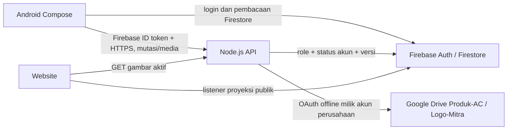

# Google Drive terpusat + Firestore

**Panduan aktif 1.2.1:** gunakan [login Google dan izin Drive setelah login](LOGIN_DRIVE.md). Bagian backend/login password di bawah merupakan catatan jalur lama; backend tidak diperlukan untuk gambar Android 1.2.1.


**Jalur aktif sejak 1.0.4:** [Google Drive langsung dari Android](NATIVE_DRIVE.md), dengan akun utama diotorisasi pada setiap HP sesuai persetujuan pengguna. Upload, baca gambar, simpan/edit/arsip katalog memakai Drive API v3 dan Firestore langsung. Bagian Node/OAuth Web di bawah merupakan dokumentasi jalur existing untuk kompatibilitas, bukan syarat jalur native.

Integrasi memperluas proyek yang ada. MVC Compose, controller `ViewModel`/`StateFlow`, login Firebase, daftar/formulir, multi-image, versi dokumen, soft delete, dan tema website dipertahankan. Google Drive menyimpan gambar dan Firestore menyimpan metadata.

**Status HP:** kegagalan terakhir menunjukkan API lokal `10.0.2.2` tidak dapat dijangkau dari HP. Alamat itu adalah host khusus Android Emulator, sehingga pesan tersebut belum membuktikan adanya pembatasan perangkat oleh Google. Pemeriksaan konfigurasi Cloud masih berlangsung; upload Drive pada HP mandiri belum dinyatakan berhasil.

**Percobaan Apps Script dibatalkan sesuai permintaan pengguna.** Tidak ada URL script yang dipublikasikan ke konfigurasi aplikasi dan APK kembali memakai integrasi Node.js existing. Kode script yang tertinggal hanya referensi percobaan, bukan instruksi aktivasi. Pembatalan deployment percobaan sedang ditangani; status akhirnya perlu diverifikasi terpisah. OAuth Web client, secret environment, dan perintah Node di bawah tetap berlaku untuk integrasi yang sudah ada.

**Perubahan login 1.0.1:** Firebase Authentication dan profil Firestore diperiksa langsung dari Android, termasuk claim OWNER/ADMIN, profil aktif dengan role cocok, dan cutoff pencabutan sesi. Beranda membaca query Firestore berpaginasi dari server. App Check Android sudah dihapus; login dan pembacaan Firestore tidak memerlukan registrasi HP, USB, atau API lokal. Simpan/upload dan pembacaan gambar Drive tetap menggunakan backend berikut.

## Konfigurasi yang sudah diperiksa

- Firebase: `jayagunatehnikperkasa`, tetap memakai `app/google-services.json`.
- Folder Produk-AC: **`1RN6CPWKQ2i7rpgvxE3EUG0ndyuEm3NUd`**.
- Folder Logo-Mitra: **`1fEw1ct_IRe9LB0u5n24gzBEOVQ2ekom6`**.
- `functions/.env` lokal sudah berisi kedua ID folder dan kunci AES acak. File ini diabaikan Git. Tidak ada folder Drive baru yang dibuat.
- JSON pada Downloads yang diberikan berjenis `installed`, tanpa client secret. File itu tidak disalin ke repo/APK dan belum dipakai untuk OAuth backend. Project OAuth di dalamnya adalah `jayagunatehnikperkasa-512819`, berbeda dari project Firebase; hal ini diperbolehkan jika Drive API/consent dikonfigurasi pada project OAuth yang benar.
- JSON kedua yang diberikan sudah lolos validasi **Web application** beserta redirect localhost dan berasal dari project OAuth **`jayagunatehnikperkasa-512819`**. Client yang dipakai backend cocok dengan JSON tersebut; konfigurasi diimpor tanpa menyalin file JSON ke repo. Email akun utama adalah **`mtahakurniawan@gmail.com`**; project Firebase tetap **`jayagunatehnikperkasa`**.
- File Firebase Admin yang diberikan tetap di luar source; environment hanya menyimpan path. Pemeriksaan **Firebase Auth dan Firestore asli berhasil**, OWNER aktif, dan grant Drive sudah tersedia.
- Pemilik akun sudah berhasil login pada APK terbaru; sesi kemudian dipulihkan dan dashboard berhasil dimuat tanpa memasukkan kata sandi ulang. Navigasi OWNER terverifikasi.
- Pengguna mengonfirmasi Audience **External** dan `mtahakurniawan@gmail.com` sebagai test user. Kegagalan `org_internal` sudah terselesaikan; setelah persetujuan, OWNER melaporkan callback **Google Drive terhubung**. `check:backend -- --drive` mengonfirmasi **`checked:true`**, **`driveConnected:true`**, dan **`foldersVerified:true`**, beserta akses Firebase Auth/Firestore asli.
- Pemeriksaan baca saja pada Firestore menemukan produk draft yang benar-benar dibuat pengguna, **`ac`**, dengan satu gambar Drive dan registry media berstatus **`attached`**. Upload gambar produk asli beserta penyimpanan metadata telah terjadi; tidak membuat produk uji fiktif. Verifikasi bytes/metadata, audit, akses privat, dan tampilan gambar Android masih diperiksa terpisah.
- Drive API pada project OAuth `jayagunatehnikperkasa-512819` sudah diperiksa dan berstatus **ENABLED**; tidak mengubah API atau IAM pada pemeriksaan ini.
- **Masih diperlukan:** pengujian langsung logo mitra, penggantian/penghapusan gambar, website publik, serta server HTTPS untuk produksi. Keberhasilan OAuth dan satu upload produk tidak membuktikan seluruh skenario tersebut atau verifikasi Google untuk produksi.

Folder ID adalah bagian setelah `/folders/` pada tautan Drive, tanpa parameter `?`. Kedua ID di atas sudah diambil dari tautan Anda; tidak perlu membuat atau membagikan folder menjadi publik. Proses OAuth akan memeriksa keberadaan, izin tulis, dan akses privat menggunakan akun perusahaan yang dipilih.

## File yang dibuat atau diubah

Path Android berikut berada di `app/src/main/java/com/jayaguna/admin/`.

| Bagian | File dan perubahan |
|---|---|
| Backend baru | `functions/src/server.ts`; `functions/src/drive/config.ts`, `crypto.ts`, `image.ts`, `oauth.ts`, `transport.ts`, `media.ts`: HTTP API, OAuth, enkripsi, validasi, Drive v3, registry, cleanup, audit |
| Backend existing | `functions/src/schema.ts`, `functions/src/service.ts`: perluasan metadata, upload Drive, transaksi entity/media tanpa menghapus jalur legacy |
| Konfigurasi backend | `functions/package.json`, `functions/package-lock.json`, `functions/.env.example`, `functions/scripts/configure-drive.cjs`, `functions/scripts/configure-firebase.cjs`, `functions/scripts/check-backend.cjs`, `functions/scripts/activate-owner.cjs`, `functions/Dockerfile`, `functions/.dockerignore`, `.gitignore`; environment lokal `functions/.env` tidak dikomit |
| Android transport dan repository | `data/remote/BackendApi.kt` (baru), `data/repository/FirebaseRepository.kt`, `data/repository/MediaRepository.kt` |
| Model dan DI Android | `data/model/Models.kt`, `data/remote/Mappers.kt`, `AdminApplication.kt`, `core/security/AppError.kt`, `core/components/DraftSavers.kt`, `app/build.gradle.kts` |
| Login dan sesi | `features/auth/controller/AuthController.kt`, `AuthGateway.kt`, `features/auth/view/LoginScreen.kt`; retry sesi, pembatalan logout dan pengujian pada `app/src/test/java/com/jayaguna/admin/features/auth/controller/AuthControllerTest.kt` |
| Launcher pengembangan | `scripts/run-local.ps1`; backend latar, health, port forwarding dan pemasangan APK; `local.properties` menyimpan URL debug secara lokal dan diabaikan Git |
| UI/controller Android | `features/dashboard/controller/AdminController.kt`, `features/auth/view/AccountScreen.kt`, `features/products/view/ProductsScreen.kt`, `core/navigation/AdminApp.kt`: koneksi OWNER, status dan konfirmasi hapus gambar |
| Firestore | `firestore.rules`, `firestore.indexes.json`: audit backend dan index cleanup; sudah dideploy ke project asli, index baru perlu selesai dibangun |
| Website | `web-integration/helpers.js`, `catalog.js`, `firebase-client.js`, `firebase-config.example.js`, `test/helpers.test.js`: origin backend, unduhan Drive, fallback dan pengujian |
| Test backend | `functions/test/drive.test.mjs`, `functions/test/drive-emulator.test.mjs` (baru), `functions/test/emulator.test.mjs` (penolakan akses collection server) |
| Dokumentasi | `docs/GOOGLE_DRIVE.md` (baru), `docs/VERIFICATION.md`, `docs/FIREBASE_SETUP.md`, `README.md`, `functions/README.md`, `web-integration/README.md` |

Dependency produksi yang ditambahkan secara eksplisit: **`google-auth-library` versi `9.15.1`** pada backend. Library Firebase Admin, Zod, dan Sharp yang sudah ada dipakai kembali. Android menggunakan Firebase SDK, Photo Picker, coroutines, dan `HttpURLConnection` yang tersedia; dependency test **`kotlinx-coroutines-test:1.10.2`** ditambahkan untuk memeriksa retry, pencabutan akses dan pembatalan sesi. Tidak menambahkan SDK OAuth/Drive atau secret ke APK.

## Arsitektur



Backend standalone menggunakan `functions/src/server.ts` dan **service/repository bisnis TypeScript yang sama** dengan callable functions lama. Tidak perlu membuat proyek baru. Hosting backend dapat berupa VM/container/server Node.js HTTPS yang tepercaya; jika memilih Cloud Functions/Cloud Run, kebutuhan billing penyedia hosting tetap berlaku. Menggunakan Drive menggantikan kebutuhan **Firebase Storage untuk upload baru**, bukan menghilangkan kebutuhan server yang menjalankan kode dan memverifikasi token.

Hanya OWNER yang menghubungkan akun Google Drive utama melalui halaman Akun. ADMIN tetap masuk memakai email/password Firebase masing-masing; mereka tidak login atau mengetahui password/token Drive perusahaan.

Untuk OWNER yang dibuat saat bootstrap, kata sandi acak awal tidak dibagikan. Di workstation Windows tepercaya yang sudah memiliki ADC Firebase, jalankan `npm.cmd --prefix functions run owner:activate`. Script memverifikasi akun/profil OWNER aktif, lalu membuka halaman resmi Firebase agar pemilik mengatur kata sandinya sendiri. Tidak mengirim email, mengganti sandi otomatis, atau mencetak/menyimpan URL reset. Setelah itu masuk melalui aplikasi. Ini helper operator lokal, bukan endpoint aktivasi publik.

## Environment backend

Gunakan Node.js **22**. Isi `functions/.env` pada workstation, atau secret/environment platform hosting. Jangan menaruh isinya pada Android, modul JS website, atau Firebase client config.

| Variable | Isi |
|---|---|
| `FIREBASE_PROJECT_ID` | `jayagunatehnikperkasa` |
| `MEDIA_PROVIDER` | `drive` |
| `BACKEND_PUBLIC_URL` | Origin HTTPS backend; pengembangan lokal `http://localhost:8787` |
| `HOST`, `PORT` | Lokal `127.0.0.1`, `8787`; container memakai `0.0.0.0` |
| `GOOGLE_DRIVE_PRODUCTS_FOLDER_ID` | ID Produk-AC di atas |
| `GOOGLE_DRIVE_PARTNERS_FOLDER_ID` | ID Logo-Mitra di atas |
| `GOOGLE_DRIVE_ACCOUNT_EMAIL` | Email Google yang memiliki kedua folder |
| `GOOGLE_OAUTH_CLIENT_ID`, `GOOGLE_OAUTH_CLIENT_SECRET` | Dari OAuth client Web application yang asli |
| `GOOGLE_OAUTH_REDIRECT_URI` | Persis `BACKEND_PUBLIC_URL` + `/api/drive/oauth/callback` |
| `DRIVE_TOKEN_ENCRYPTION_KEY` | Base64 dari 32 byte acak; sudah dibuat lokal, simpan dan backup pada secret store server |
| `ALLOWED_ORIGINS` | Daftar origin website, dipisahkan koma; tanpa wildcard |
| `ENFORCE_APP_CHECK` | `false` pada konfigurasi saat ini; hanya `true` eksplisit yang mengaktifkan pemeriksaan tambahan backend. Android saat ini tidak mengirim token App Check |
| `TRUST_PROXY_HOPS` | `0` langsung; atur sesuai jumlah reverse proxy tepercaya. Jangan percaya X-Forwarded-For tanpa konfigurasi ini |
| `GOOGLE_APPLICATION_CREDENTIALS` | Opsional lokasi credential **Firebase backend** di luar repo, jika tidak memakai attached IAM/ADC |

Tidak memakai service account sebagai pemilik Drive pribadi. Service account/ADC hanya untuk Firebase Admin pada backend; penyimpanan Drive memakai OAuth akun manusia perusahaan.

## OAuth awal khusus OWNER

1. Di Google Cloud Console project OAuth, aktifkan **Google Drive API** dan lengkapi OAuth consent screen.
2. Buat **OAuth client ID → Web application**. Untuk localhost tambahkan Authorized redirect URI:

   ```text
   http://localhost:8787/api/drive/oauth/callback
   ```

   Untuk produksi, gunakan callback HTTPS domain backend yang sebenarnya. Jangan memakai URL Android Emulator `10.0.2.2` sebagai redirect browser komputer.
3. Unduh JSON Web client. Import ke environment backend tanpa mencetak secret:

   ```powershell
   npm.cmd --prefix functions run configure:drive -- --oauth-file "C:\lokasi\oauth-web.json" --account-email "EMAIL_DRIVE_UTAMA"
   ```

   Skrip menolak credential installed/Android, memeriksa redirect URI, mempertahankan kunci enkripsi yang sudah ada, dan tidak menyalin JSON asli.
4. Tambahkan akun Drive utama sebagai test user jika consent screen masih Testing. **External app dalam Testing dapat menghasilkan refresh token yang kedaluwarsa setelah 7 hari untuk scope Drive.** Untuk operasi jangka panjang, selesaikan status publikasi/verifikasi Google yang berlaku.
5. Jalankan backend dan login OWNER pada Android. Buka **Akun & perangkat → Google Drive perusahaan → Hubungkan Google Drive**. Pilih akun Drive utama yang tepat di browser.
6. Backend memakai `state` sekali pakai (10 menit), PKCE, dan ID token Google untuk memverifikasi email/subjek. Kedua folder harus ada, dapat ditulis, dan tidak memiliki izin publik/domain. Baru kemudian refresh token disimpan terenkripsi.
7. Setelah callback menampilkan berhasil, kembali ke aplikasi lalu tekan **Periksa koneksi Drive**. Akun lain tidak dapat mengganti akun perusahaan secara diam-diam; migrasi akun perlu peninjauan operator.

### Jika Google menampilkan Error 403: `org_internal`

Error ini berasal dari Audience pada project OAuth **`jayagunatehnikperkasa-512819`**. **Internal** membatasi persetujuan ke anggota organisasi Google Workspace; akun Gmail pribadi tetap dikecualikan meskipun memiliki role OWNER di aplikasi Firebase atau IAM Owner pada project. [Penjelasan resmi Audience Google](https://support.google.com/cloud/answer/15549945?hl=en).

1. Buka [Audience pada project OAuth yang benar](https://console.cloud.google.com/auth/audience?project=jayagunatehnikperkasa-512819).
2. Atur **User type: External** dan **Publishing status: Testing**.
3. Pada **Test users**, tambahkan **`mtahakurniawan@gmail.com`**, lalu simpan. [Panduan resmi konfigurasi consent dan test user](https://developers.google.com/workspace/guides/configure-oauth-consent).
4. Kembali ke aplikasi dan mulai **permintaan baru** melalui **Hubungkan Google Drive**. State backend berlaku 10 menit; jangan mengulang tautan OAuth lama.

Riwayat perbaikan: pengguna mengonfirmasi External dan penambahan email utama sebagai test user. Permintaan baru melewati `org_internal` dan menampilkan peringatan aplikasi belum diverifikasi beserta akses tahap pengujian. Pengguna kemudian menyelesaikan persetujuan hingga callback **Google Drive terhubung**; pemeriksaan backend memverifikasi grant dan kedua folder. Ini tidak berarti aplikasi sudah diverifikasi Google untuk produksi.

Client Web yang ada cocok dengan backend dan tidak perlu diganti hanya untuk memperbaiki Audience. Import JSON baru hanya jika client di Console memang berubah. Project Firebase tetap `jayagunatehnikperkasa`; jangan mengganti konfigurasi Firebase Android.

Scope yang diminta adalah `openid`, `email`, dan `https://www.googleapis.com/auth/drive` agar folder yang **sudah ada** dapat diakses berdasarkan ID. Scope Drive ini luas/restricted dan dapat memerlukan verifikasi Google. Semua operasi aplikasi tetap dibatasi ke dua folder terkonfigurasi dan file registry yang dibuat backend. Mengganti scope menjadi `drive.file` memerlukan alur Google Picker untuk memberikan akses folder yang sudah ada; mengganti string scope saja tidak cukup.

Refresh token dienkripsi AES-256-GCM pada `backendSecrets/googleDrive`; collection tersebut tidak dapat dibaca client termasuk OWNER/ADMIN. Kunci enkripsi tetap di secret store/environment backend. Access token diperbarui dengan `google-auth-library`; token dan objek error OAuth tidak ditulis ke log. Jika refresh token dicabut, OWNER harus menghubungkan ulang. Jangan mengganti/menghilangkan kunci enkripsi tanpa rencana pemulihan.

## Menjalankan backend

Firebase CLI login bukan otomatis ADC server. Untuk produksi di Google Cloud, gunakan attached IAM/workload identity. Pada server lokal/non-Google, Firebase mendukung credential service account server di luar source:

```powershell
$env:GOOGLE_APPLICATION_CREDENTIALS="C:\lokasi-aman\firebase-backend.json"
```

Pada Firebase Console project `jayagunatehnikperkasa`, buka Project settings → Service accounts → Firebase Admin SDK → Generate new private key. Simpan JSON di komputer/server yang tepercaya, kirim hanya lokasi file jika perlu dibantu, lalu isi `GOOGLE_APPLICATION_CREDENTIALS` pada shell atau environment backend. Jangan menyalin isinya ke chat, repo, Drive, website atau APK. Credential ini hanya untuk Firebase Auth/Firestore; pemilik penyimpanan Drive tetap akun Google perusahaan melalui OAuth.

Konfigurasi workstation ini sudah selesai dan lolos `check:backend`. Untuk mengatur ulang path dengan validasi project tanpa menyalin key:

```powershell
npm.cmd --prefix functions run configure:firebase -- --credential-file "C:\lokasi-aman\firebase-backend.json"
```

Alternatif tanpa service-account key: Google Cloud CLI ADC memakai **OAuth client Desktop milik sendiri** (`gcloud auth application-default login --client-id-file=PATH_DESKTOP_JSON`), atau service-account impersonation dengan izin IAM yang sesuai. Login ADC biasa menggunakan client bawaan gcloud tidak didukung Firebase Authentication Admin; jangan menganggap `gcloud auth application-default login` saja cukup. Akun IAM backend perlu izin Firestore dan Firebase Authentication yang diperlukan. Lihat [panduan resmi Firebase tentang kredensial end-user](https://firebase.google.com/docs/admin/setup#testing_with_gcloud_end_user_credentials).

```powershell
npm.cmd --prefix functions ci
npm.cmd --prefix functions run build
npm.cmd --prefix functions run check:backend
cd functions
npm.cmd run start:api
```

Periksa `http://localhost:8787/healthz`. Respons health hanya menunjukkan proses HTTP hidup, bukan bahwa OAuth, ADC, dan upload sudah berhasil. Hentikan dan jalankan ulang proses setelah mengubah `.env`.

`check:backend` hanya membaca konfigurasi, profil OWNER dan Firebase Auth melalui ADC; tidak mencetak credential. Sebelum OAuth, `driveConnected:false` wajar. Sesudah persetujuan OWNER, jalankan `npm.cmd --prefix functions run check:backend -- --drive` untuk memeriksa akses asli ke kedua folder. Kegagalan menyebut tahap, tanpa mencetak objek error yang mungkin mengandung token.

Produksi: gunakan HTTPS reverse proxy, `NODE_ENV=production`, origin CORS yang tepat, secret environment, IAM minimal, dan Node22. Dockerfile serta `.dockerignore` tersedia di `functions/`; environment/credential harus dipasok runtime, bukan dimasukkan image. Cache/rate limiting bawaan berlaku per proses; untuk beberapa replica pasang rate limiting terpusat di reverse proxy/gateway atau Redis. Batasi CPU/memori serta jumlah instance di host.

Rules/index integrasi sudah direview, diuji dan dideploy ke project asli pada pekerjaan ini. Perintah untuk deployment berikutnya setelah review:

```powershell
firebase.cmd deploy --project jayagunatehnikperkasa --only "firestore:rules,firestore:indexes"
```

Deployment berhasil: rules `audit_logs` aktif dan seluruh **22 index berstatus READY**, mencakup 19 index lama dan 3 tambahan Drive. Collection secret/media tetap ditolak bagi client. Tidak perlu deploy Storage Rules untuk gambar baru Drive; jangan menghapus rules/data Storage lama jika masih digunakan.

## Menjalankan Android

Android Emulator tetap memakai Firebase asli. Untuk backend lokal komputer:

```powershell
.\scripts\run-local.ps1
```

Launcher sudah diuji dari kondisi backend mati: memulai server tersembunyi, memeriksa health, memasang APK dan membuka MainActivity pada `emulator-5554`. Log backend disaring tanpa mencetak token di `.artifacts/backend-local.*.log`. `-SkipInstall` memakai APK yang sudah terpasang; `-DeviceSerial` memilih perangkat tertentu. Tidak mematikan proses lain pada port yang terpakai.

Pada workstation ini, `local.properties` yang diabaikan Git berisi:

```properties
backend.debugBaseUrl=http://10.0.2.2:8787
```

Android Studio Run memakai nilai tersebut untuk debug tanpa memerlukan flag tambahan. Nilai lokal tidak masuk konfigurasi release. Build manual juga dapat memberikan override eksplisit:

```powershell
.\gradlew.bat :app:installDebug -PbackendBaseUrl=http://10.0.2.2:8787
```

`10.0.2.2` adalah komputer host dari Android Emulator. Backend tetap localhost pada browser komputer untuk callback OAuth. Untuk operasi API/media, HP fisik memerlukan alamat API yang dapat dijangkau; mode HTTP debug hanya menerima localhost/10.0.2.2. Login dan pembacaan Firestore tidak memakai alamat ini. Release wajib origin HTTPS untuk API.

Jika persetujuan Google dibuka di **browser Android Emulator**, forward localhost callback emulator ke komputer sebelum menghubungkan Drive:

```powershell
& "$env:LOCALAPPDATA\Android\Sdk\platform-tools\adb.exe" -s emulator-5554 reverse tcp:8787 tcp:8787
```

Sesuaikan serial dari `adb devices` jika berbeda. Tanpa forwarding, `http://localhost:8787` di browser emulator mengarah ke emulator sendiri. Untuk HP fisik/produksi gunakan domain backend HTTPS pada konfigurasi OAuth dan aplikasi.

Build release:

```powershell
.\gradlew.bat :app:assembleRelease -PbackendBaseUrl=https://api.DOMAIN_ANDA
```

Jika URL backend kosong, operasi API menampilkan pesan konfigurasi; tidak otomatis beralih ke Cloud Functions yang belum dideploy. Jalur callable lama masih tersedia jika operator secara eksplisit membangun dengan `-PuseLegacyFunctions=true`. **Upload baru tetap memerlukan backend Drive**. Alamat backend bukan secret. Firebase ID token dikirim dalam header; seluruh jaringan HTTP berjalan di `Dispatchers.IO`.

Login memerlukan pembacaan profil Firestore dari server. Kegagalan jaringan sementara mempertahankan identitas Firebase dan menyediakan **Coba periksa akses lagi**. Sesi yang dicabut, akun nonaktif atau role ditolak tetap dikeluarkan. Logout membatalkan verifikasi yang sedang berjalan; respons terlambat tidak dapat mengembalikan akun ke aplikasi. Kegagalan API lokal tidak lagi menjadi syarat pembukaan Beranda. Kegagalan membuka browser OAuth ditampilkan sebagai error yang bisa dicoba ulang.

## API dan data Firestore

| Endpoint | Hak akses dan fungsi |
|---|---|
| `POST /api/call/{name}` | Firebase ID token dan role/profil aktif. Service save/archive/manageAdmin serta endpoint login/dashboard lama yang tetap kompatibel |
| `POST /api/call/startDriveOAuth`, `getDriveStatus` | OWNER saja, payload JSON `{}` |
| `GET /api/drive/oauth/callback` | State/PKCE sekali pakai; tidak menerima role/email client sebagai identitas |
| `POST /api/call/beginUpload` | Membuat lease dan pre-generated Drive File ID, tanpa menyimpan bytes di Firestore |
| `PUT /api/uploads/{mediaId}` | Body biner PNG/JPEG/WebP, Firebase ID token dan izin akun, batas5MiB |
| `GET /api/media/{mediaId}` | Publik hanya jika gambar masih direferensikan proyeksi entitas aktif; staff aktif dapat melihat draft |
| `GET /api/media/{mediaId}/metadata` | Staff aktif, metadata dari Drive/registry diverifikasi |
| `DELETE /api/media/{mediaId}` | Pembuat unggahan atau OWNER; wajib `requestId` dan `device`, menolak gambar yang masih direferensikan |
| `POST /api/media/cleanup` | OWNER, JSON `requestId` dan `device`, membersihkan batch orphan/expired/detached secara aman |

`storagePath` lama dipertahankan sebagai kunci gambar/formulir. Untuk Drive nilainya adalah **referensi logis** `drive/{UUID_MEDIA}`, bukan lokasi Firebase Storage. `mainImagePath` tetap memilih referensi tersebut sehingga urutan dan gambar utama tidak berubah.

```json
{
  "storagePath": "drive/UUID_MEDIA",
  "provider": "drive",
  "driveFileId": "FILE_ID_ASLI_DRIVE",
  "fileName": "gambar-1.png",
  "mimeType": "image/png",
  "sizeBytes": 12345,
  "url": "https://api.DOMAIN_ANDA/api/media/UUID_MEDIA"
}
```

Produk menyimpan objek ini pada `images`; mitra pada `logo`. Status produk tetap `draft/active/inactive`, mitra tetap `active`; tidak diganti menjadi schema contoh yang akan merusak kompatibilitas. Timestamp, UID pembuat/pengubah, version, dan proyeksi publik tetap dibuat server. Tidak ada Base64 gambar dalam Firestore.

Collection tambahan: `mediaAssets` (registry/state media), `driveUploadRequests` (idempotensi), `driveOAuthStates` (state/PKCE terenkripsi), `backendSecrets` (grant terenkripsi), dan `audit_logs` (upload/replace/remove/delete). Semuanya backend-only untuk write. `audit_logs` dapat dibaca OWNER, atau ADMIN untuk `userId` miliknya dengan query terfilter. `activityLogs` lama tetap mencatat perubahan entitas beserta before/after gambar.

## Retry, penggantian, dan cleanup

- Backend memeriksa ukuran, MIME, magic bytes, decode40MP maksimal; mengatur orientasi, ukuran4096px, dan menghapus metadata/EXIF dengan Sharp. PNG transparan tetap didukung.
- `requestId` dan hash berkas dipertahankan selama retry. Backend mencadangkan Drive File ID sebelum upload; retry kehilangan respons menggunakan ID sama, menangani409, dan memverifikasi hash/parent/asset ID sehingga tidak membuat file ganda.
- File baru dibuat privat di folder yang sudah ada. Google Drive tidak ditransaksikan bersama Firestore. Upload yang selesai tetapi commit gagal ditahan sebagai orphan privat; tidak mengganti metadata produk/logo lama.
- Save memeriksa versi dokumen dan state seluruh media dalam transaksi. Entitas, proyeksi publik, `activityLogs`, `audit_logs` perubahan gambar, receipt, dan state attach/detach disimpan atomik.
- Gambar yang dilepas dari entitas ditandai `detached` dan diberi tenggang24jam. Jalankan cleanup dari akun OWNER atau worker terotorisasi pada host. Cleanup bukan jadwal otomatis Cloud Functions; tanpa pemanggilan cleanup file orphan tetap privat dan memakai kuota Drive.
- Delete mengambil lock state `deleting`, membaca ulang referensi entitas **termasuk arsip**, lalu memindahkan file terkelola ke Trash. Transaksi save menolak state deleting/deleted. Tidak menghapus file yang masih dipakai. Trash mengikuti retensi Google Drive; audit metadata tetap ada.
- Media dalam audit historis dapat menunjuk file yang sudah di-Trash setelah tidak dipakai entitas; tidak ada janji mempertahankan binary seluruh versi selamanya.
- Endpoint gambar memeriksa proyeksi terbaru **sebelum** cache dan304. Cache byte backend dibatasi32MiB/5menit, browser publik wajib revalidasi, request staff `no-store`. Tidak membuat permission anyone atau URL thumbnail/download-token Drive. File hilang/berubah menghasilkan error/fallback.

## Website

Isi `backendBaseUrl` pada `web-integration/firebase-config.js` dan `ALLOWED_ORIGINS` backend dengan origin website. Pemasangan mount point/CSS tetap sama. `mountCatalog` kini menerima `{db, storage, backendBaseUrl, productsRoot, partnersRoot}`. File baru Drive dibaca melalui backend; gambar Storage lama tetap memakai `getBlob` dan rules Firebase. File ID Drive bukan bukti akses dan tidak dipakai langsung sebagai URL gambar publik.

## Pengujian dan batas verifikasi

Hasil lokal terakhir: **21/21 backend unit/HTTP**, **17/17 Firebase Emulator integration**, **7/7 web**, dan **14/14 Android unit** lulus. Build debug tanpa flag URL, lint (0 error/10 warning pembaruan dependency/resource), kompilasi Kotlin release, serta pemeriksaan sintaks web berhasil. Pengujian HTTP lokal memperoleh health 200 dan akses tanpa token 401. Detail dan batas verifikasi ada di [VERIFICATION.md](VERIFICATION.md).

```powershell
npm.cmd --prefix functions test
firebase.cmd emulators:exec --project demo-jayaguna --only "auth,firestore,storage" "npm.cmd --prefix functions run test:emulator"
npm.cmd --prefix web-integration test
npm.cmd --prefix web-integration run check
.\gradlew.bat :app:assembleDebug :app:testDebugUnitTest :app:compileReleaseKotlin
```

Test integrasi memakai Firestore/Auth Emulator **hanya untuk pengujian**, dengan transport Drive tiruan. Suite tersebut tidak mengganti APK menjadi mode demo atau mengunggah file uji ke akun perusahaan. Hasil nyata diperiksa terpisah: OAuth dan kedua folder terverifikasi melalui `check:backend -- --drive`, lalu produk draft `ac` buatan pengguna tersimpan dengan satu media Drive berstatus `attached`. Pengujian logo, penggantian/penghapusan, dan website publik masih belum dilakukan secara langsung; hasil suite lokal tidak menjadi bukti keberhasilan seluruh alur produksi.

Uji manual setelah konfigurasi: login OWNER, hubungkan Drive, login dua ADMIN berbeda, upload produk multi-image dan PNG logo, verifikasi parent folder di Drive; putus jaringan lalu retry; edit versi sama di dua perangkat; ganti logo dan pastikan lama tetap tampil ketika upload baru gagal; cabut OAuth dan pastikan pesan reconnect; draft/arsip harus menghilangkan akses publik; jalankan cleanup dan pastikan gambar terpakai tidak dihapus.

Referensi resmi: [OAuth offline Web server](https://developers.google.com/identity/protocols/oauth2/web-server), [upload Drive](https://developers.google.com/workspace/drive/api/guides/manage-uploads), [pre-generated IDs dan retry409](https://developers.google.com/workspace/drive/api/guides/create-file), [scope Drive](https://developers.google.com/workspace/drive/api/guides/api-specific-auth), [download](https://developers.google.com/workspace/drive/api/guides/manage-downloads), [penanganan error](https://developers.google.com/workspace/drive/api/guides/handle-errors).
